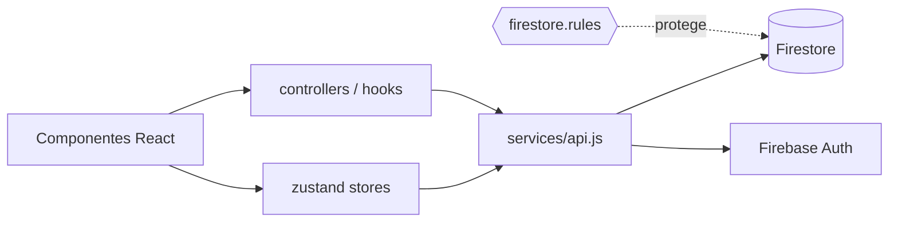

# Arquitectura

**Stack:** React 18 + Vite 5 · Firebase (Auth + Firestore) · Leaflet · recharts · zustand · Vercel.
**No hay backend propio**: el navegador escribe directamente en Firestore. La única barrera de seguridad son las `firestore.rules`.

## Módulos
| Carpeta | Responsabilidad |
|---|---|
| `src/components/` | Pantallas públicas (búsqueda, detalle, reservas, cuenta) |
| `src/components/dashboard/` | Panel del restaurante (empresa) |
| `src/components/ops/` | Operator Hub (admin) |
| `src/components/points/` | Puntos MIRA, racha, invitaciones |
| `src/services/` | Acceso a Firestore / APIs externas (Geoapify, tiempo) |
| `src/stores/` | Estado global con zustand |
| `src/i18n/` | Traducciones es / ca / en |

Relacionado: [[Hallazgos de revisión]] (por qué "sin backend" es el problema de fondo).
